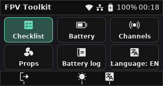
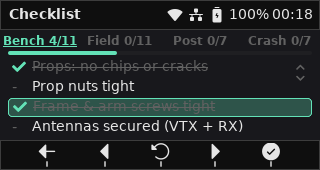
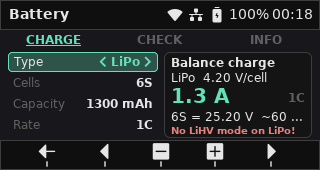
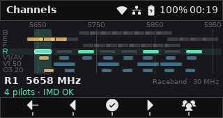
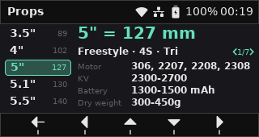
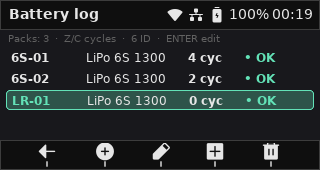

# FPV Toolkit for CardputerZero

A pocket field tool for FPV pilots: pre-flight checklists, battery charging & voltage helper,
5.8 GHz channel planner with IMD check, prop size lookup and a battery log.
Works fully offline, keyboard only. English / Українська.

<p>
  
  
  
  
  
  
</p>

## Features

| Tab | What it does |
| --- | --- |
| **Checklist** | Bench (before leaving home), Field (before takeoff), Post-flight and Crash inspection lists with progress per list. |
| **Battery** | *Charge*: charger settings for LiPo / LiHV / Li-ion — mode, end voltage, cell count, current at 0.5C / 1C / 2C. *Check*: per-cell voltage, estimated charge, status (full / storage / land now) and flight time. *Info*: full / storage / landing / minimum voltages per chemistry. |
| **Channels** | Spectrum view of analog bands A/B/E/F/R, DJI V1/Avatar (25/50 Mbps), DJI O3, DJI O4 and HDZero, drawn with real channel bandwidths. Shows overlaps, lets you mark your group's channels and checks IMD (2·f1 − f2). Includes Oscar Liang's recommended sets for 2–6 pilots. |
| **Props** | 31 mm whoop props up to 20" in millimetres, with typical motor size, KV, battery and dry weight per build class. |
| **Battery log** | Your packs with an ID that matches the label on the battery, cycle counter and condition (OK / Watch / Retire), plus retirement hints. |

State (checked items, settings, battery log) is saved to `~/.config/fpv-checklist/state.conf`.

## Controls

| Key | Action |
| --- | --- |
| `F` `X` / ↑ ↓ | Move / select field |
| `Z` `C` / ← → | Switch list, change value, move channel |
| `Enter` / `Space` | Open, check item, mark channel |
| `4`–`8` | Actions shown on the bottom bar |
| `ESC` | Back to menu (hold on the menu to exit) |
| `T` / `L` | Light-dark theme / language EN-UA |
| `Fn`+`H` | Keyboard help for the current tab |

## Data sources

Reference data is taken from published guides, not invented:

- Batteries & charging — Oscar Liang:
  [LiPo guide](https://oscarliang.com/lipo-battery-guide/),
  [how to charge](https://oscarliang.com/how-to-charge-lipo-batteries/),
  [Li-ion for long range](https://oscarliang.com/li-ion-battery-long-range/)
- Channels — Oscar Liang, [5.8 GHz FPV channels](https://oscarliang.com/fpv-channels/) (incl. DJI O3 chart)
- DJI O4 — DJI O4 Air Unit Series User Manual v1.0 (2025.01), section 4.4
- Props — Oscar Liang, [motor & prop lookup table](https://oscarliang.com/table-prop-motor-lipo-weight/)

Charge % for LiHV / Li-ion and Li-ion storage voltage are estimates — always check your cell datasheet.

## Build

Built on the official [CardputerZero Template](https://github.com/CardputerZero/Template) (C++17, LVGL 9.5, CMake).

### Desktop simulator (macOS, Apple Silicon)

```shell
brew install cmake ninja libpng jpeg fmt sdl2 freetype
cmake --preset darwin-arm64
cmake --build --preset darwin-arm64-dbg
./build/darwin-arm64/Debug/fpv-checklist
```

The simulator uses the same DejaVu Sans font as the device (from `tools/fonts/`, not packaged),
so text widths match the real 320×170 screen.

Scripted run for screenshots (desktop only): `FPV_DEMO_KEYS='..@\n@!'` — each character is a key press,
`@` saves a screenshot, `!` quits.

### Device package (.deb)

The device runs Debian 13 (trixie) arm64. The package is built in a matching Docker container:

```shell
brew install colima docker && colima start --arch aarch64
./scripts/build-deb.sh          # -> dist/FPVToolkit_<version>_rev1_arm64.deb
```

Install on the device:

```shell
scp dist/FPVToolkit_*_arm64.deb <user>@<device-ip>:~/
ssh -t <user>@<device-ip> 'sudo apt install -y ./FPVToolkit_*_arm64.deb'
```

The app then appears in the CardputerZero launcher.

## Українською

FPV Toolkit — кишеньковий помічник FPV-пілота для CardputerZero: чеклісти перед польотом і після краша,
налаштування зарядки LiPo / LiHV / Li-ion, перевірка напруги, спектр каналів 5.8 ГГц з перевіркою IMD,
розміри пропелерів у мм і журнал батарей з ID. Мова перемикається клавішею `L`.

## License

MIT — see [LICENSE](LICENSE). Based on the CardputerZero Template (MIT, M5Stack).
DejaVu fonts in `tools/fonts/` are under their own license (`tools/fonts/LICENSE-DejaVu.txt`).
